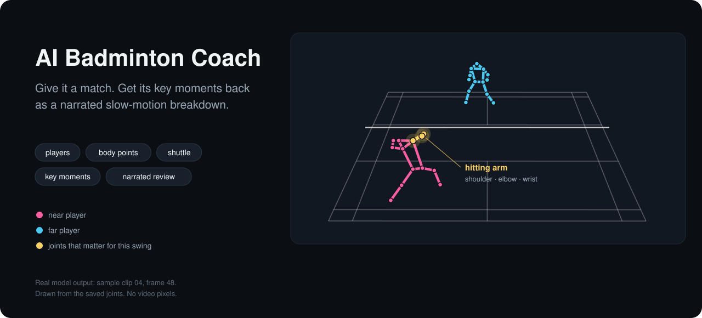
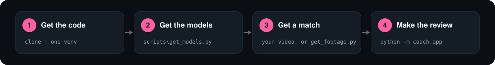
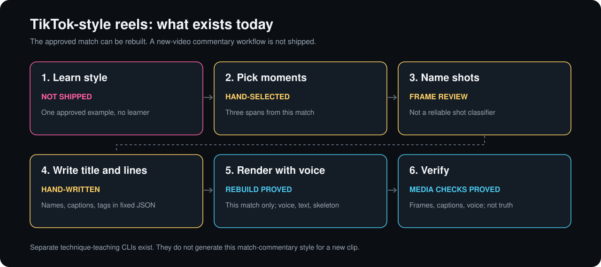
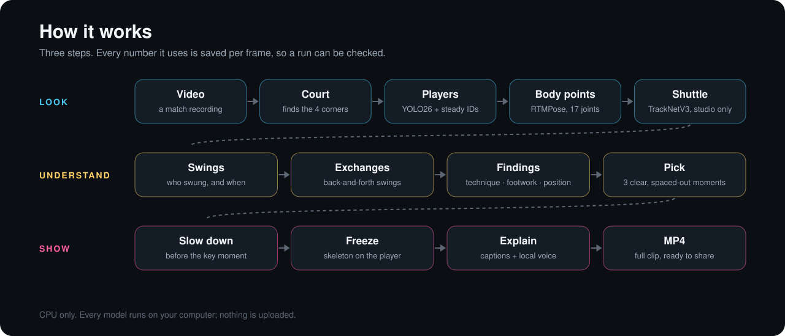
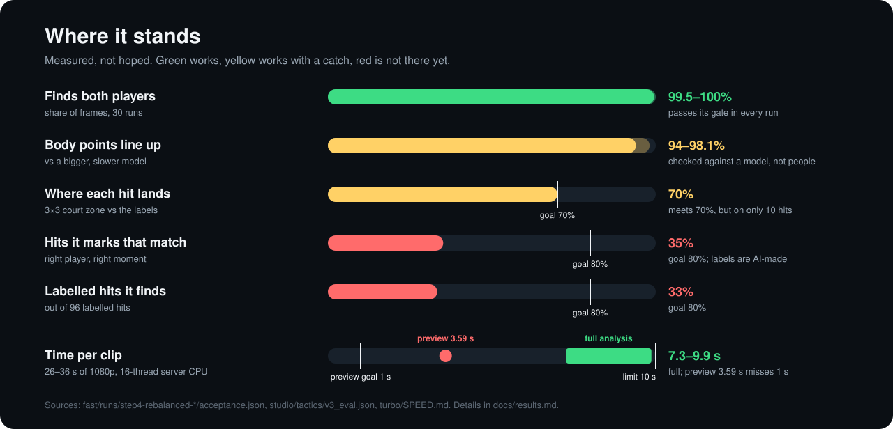

<p align="center">
  
</p>

# AI Badminton Coach

**Give it a match. Get its key moments back as a narrated slow-motion breakdown.**
It finds both players, tracks 17 body points on each, slows down the moments worth watching, freezes on the key frame with the skeleton drawn on, and explains it in a local Chinese voice.

> **Status: research MVP for Windows, CPU only.** You can run it today on your own singles clip ([Use it](#use-it)).
> Finding players and body points works well. Telling **which shot** was played is **not there yet**, and picking the most *exciting* moment is **not automatic yet**.
> Shuttle tracking is a **separate studio tool** that the app does not use. There is **no recorded human listening review** of the narration, **no test against a real coach**, and it has **not been run on a Mac**.
> See [where it stands](#where-it-stands).

## Why

Match video is the best way to see what you actually do on court. But nobody scrubs through an hour of footage, and the slow-motion breakdowns you see on TV need an editor and a coach. This project tries to do both on your own computer: find the moments worth watching, then show and explain them.

## What it does

| | You give it | Today |
|---|---|---|
| 🧍 **Players and body points** | A singles clip filmed from behind one baseline | Finds both players and 17 joints in each frame, and keeps near and far apart |
| 🎯 **What to work on** | The same clip | Findings on technique, hitting position, footwork and where you wait, plus what each player does well |
| 🐢 **Slow motion** | Click a finding | Jumps to the moment, slows down, and stops on the key frame |
| 🎬 **Narrated review** | One command | The full clip as an MP4, with three moments slowed, frozen and zoomed, and a local Chinese voice. Experimental |
| 💬 **Ask the coach** | Buttons or your own question | "How do I fix it?", exercise cards with drawn GIFs, a 1–4 week plan. Not reliable on pain questions yet |
| 🏸 **Shuttle and commentary reels** | Studio tools, not the app | TrackNetV3 shuttle path and match-specific TikTok-style reels. [Watch the results](results/) or [rebuild all three reels](docs/reproducibility.md#rebuild-the-short-reels) |
| 📱 **Vertical teaching shorts** | Separate CLI commands | `coach.short_review` and `coach.editorial_short` analyze a supplied clip for technique lessons. They do not generate the approved commentary style. [Commands and limits](coach/README.md#vertical-technique-short-experimental) |

## Use it

Needs Windows 11 (x64), Python 3.12 and [ffmpeg](https://ffmpeg.org/) on `PATH` or in `tools\`. Chinese captions use the Microsoft YaHei font that ships with Windows. No GPU needed.

```powershell
git clone https://github.com/BenNotBen1224/ai-badminton-coach.git
cd ai-badminton-coach
py -3.12 -m venv .venv
.\.venv\Scripts\python.exe -m pip install -r requirements.txt
.\.venv\Scripts\python.exe scripts\get_models.py      # player detectors + Chinese voice, once
.\.venv\Scripts\python.exe fast\prepare_cache.py      # compiles the models for your CPU, once
.\.venv\Scripts\python.exe scripts\get_footage.py     # optional: sample clips 04-10
.\.venv\Scripts\python.exe -m coach.app               # opens http://127.0.0.1:8765
```

Upload a clip in the page that opens. For the narrated review video in one go:

```powershell
.\.venv\Scripts\python.exe -m coach.complete_review sample-videos\04-china-open-ws-a.mp4 outputs\my-review
```

It writes `review.mp4`, a readable `analysis.html`, and the evidence behind every sentence (`analysis.json`, `narration.txt`, `frame-map.json`).



**Initial release checked from a fresh clone.** At revision `e27fb934`, **729 tests ran with 0 failures** (8 skipped), and the review command turned sample clip 04 into a **74-second narrated review** with every source frame kept. The record is in [docs/fresh-clone-check.md](docs/fresh-clone-check.md).

**Want to check the numbers yourself?** Start with [docs/reproducibility.md](docs/reproducibility.md). It says what re-runs from a clean clone, what needs downloads first, and what is a record only.

**Watch a finished example.** [Latest Chinese technical commentary](https://github.com/BenNotBen1224/ai-badminton-coach/releases/download/v0.1.0/technical-commentary-v2.mp4) · [Earlier editorial cut](https://github.com/BenNotBen1224/ai-badminton-coach/releases/download/v0.1.0/editorial-base-v3.mp4) · [Earlier coaching cut](https://github.com/BenNotBen1224/ai-badminton-coach/releases/download/v0.1.0/coaching-editorial-v4.mp4). These are the exact historical videos. The [reproduction guide](docs/reproducibility.md) rebuilds equivalent media from source frames, shipped pose estimates, and a small frozen-narration bundle. It also re-scores the shipped full tactics predictions and AI-made labels without running inference.

## TikTok-style commentary workflow

**The approved example can be rebuilt. Making the same style from a new video is not automated.** The repo ships the chosen spans, title, player-named shot calls, on-screen number tags, voice inputs, captions, skeletons, 9:16 renderer, and media checks for Han Yue versus Wang Zhiyi. Picking those moments, reviewing shot names, and writing those lines were editorial work. A style learner and a new-match commentary generator are not shipped.



The separate teaching CLI `coach.short_review` passed a fresh clip-04 export and encoded-output recheck. `coach.editorial_short` failed because its narration did not fit its selected footage. Neither generates this commentary format. See [what exists, what passed, and what is missing](docs/tiktok-style-workflow.md).

## How it works



Each step saves its numbers per frame, so any sentence in the narration can be traced back to the frame and joints it came from. Details: [docs/how-it-works.md](docs/how-it-works.md).

## Where it stands

| Feature | State | Latest | Compared with |
|---|---|---|---|
| Initial app run from a fresh clone | 🟢 Works | At `e27fb934`, 729 tests, 0 failures; 74 s review made | Clean clone, models downloaded |
| Rebuild the three short reels | 🟢 Works from frozen inputs | 798 / 798 / 940 output frames; source footage, captions and voice slots checked | Clean checkout, minimal reel requirements; [proof](docs/reproduction-check.md) |
| Finds both players | 🟢 Works | 99.5–100% of frames, 30 runs | Must beat the old setup on every clip; it did |
| Body points line up | 🟡 Works, judged by a model | 94–98% of joints within 5% of player height | A bigger, slower model, not people |
| Full analysis speed | 🟡 Within limit only on a quiet computer | 7.3–9.9 s per 26–36 s clip; 9.6–12.5 s in the fresh-clone re-run, with other apps busy | 10 s limit, on a 16-thread server CPU |
| Fast preview | 🔴 Too slow | 3.59 s | 1 s goal |
| Hits: right player, right moment | 🔴 Far below goal | 35% of its hits match; finds 33% of 96 labelled hits | 80% goal; labels are AI-made |
| Which shot was played | 🔴 Almost never says | Names a shot on 6 of 336 hits | Never scored |
| Picking the most exciting moment | 🔴 Not automatic | The app picks 3 clear, spaced-out moments by a fixed rule | One prototype uses hand-set scores |
| Shuttle tracking | 🟡 Studio only | Found in 233 of 282 frames of one 9-second stretch | Not checked against labels |
| Narration | 🟡 Machine-checked | Reels: audio matches the plan; speech-to-text found no dropped sounds | No recorded human listening review |



**Is it better than a coach?** Not established. Nothing here has been compared with a human coach, and the body-point and hit scores are checked against other models and AI-made labels, not people.

Every number, where it comes from, and its caveats: [docs/results.md](docs/results.md).

## Run the experiments

```powershell
.\.venv\Scripts\python.exe scripts\run_tests.py        # 5 test suites
.\.venv\Scripts\python.exe scripts\verify_manifest.py  # every file matches its recorded hash
```

The initial `e27fb934` revision's run with the models downloaded ran 729 tests and skipped 8. Each skipped test prints why. Seven need something this repo does not ship, such as the original bytes of sample clips 01, 03 or 04, hand labels that were never finished, or an opt-in flag for a slow export; one always skips by design. [docs/reproducibility.md](docs/reproducibility.md) lists all 8, the run order, and the separate new reproduction tests.

## What's next

1. **Real shot labels from a coach**, so hits and shot names are scored against people, not AI.
2. **Find 80% of hits** with the right player and moment, then start naming shots.
3. **Pick the exciting moments automatically**, keeping "exciting" and "good to learn from" as separate scores.
4. **Bring shuttle tracking into the app.**
5. **A person listens** to every narrated review before it is called finished.
6. **Run and time it on an M4 Pro MacBook.**

Each step and how we'll know it's done: [docs/roadmap.md](docs/roadmap.md).

## Repo map

```text
coach/                 the app
  app/                 local web app (python -m coach.app)
  complete_review.py   narrated review video (python -m coach.complete_review)
  short_review.py      vertical three-point teaching short (CLI-only)
  editorial_short.py   vertical chapter-based teaching short (CLI-only)
  tactics.py           hit table: who, when, where it landed (experimental)
  README.md            full app guide and its limits
fast/                  player detection + body points, the speed and accuracy checks
  weights/             the two fine-tuned body-point models (ONNX)
  runs/                accuracy and timing records
turbo/                 the fast-preview experiment (SPEED.md: not met)
studio/                tools behind the short reels
  shuttle/             TrackNetV3 shuttle tracking
  tactics/             hit-matching scores against labels
  commentary/          voice, captions and their checks
  editorial/           vertical reel scripts and renderer
train/                 how the body-point models were fine-tuned
comparison/            other pose models tried and compared
badminton_coach/       milestone 1: skeleton overlay on a video
results/               watch gallery, video links, hashes, render and evaluation records
sample-videos/         where the sample clips go, and their sources
scripts/               get_models, get_footage, run_tests, verify_manifest
tests/                 tests for the shared core
docs/                  product docs
```

## Data and models

This repo has **no video files and no downloaded model weights in git**. It ships the two small fine-tuned body-point models, code, full tactics evaluation inputs, editorial timelines, and pose estimates. Videos are [release downloads](results/). `scripts/get_models.py`, `scripts/get_footage.py`, and `scripts/get_reel_inputs.py` fetch the remaining inputs and check their hashes. Sources and licences: [docs/models-and-licences.md](docs/models-and-licences.md).

## License

No license has been chosen yet. Until one is added, all rights are reserved. Third-party models and clips keep their own licences.
