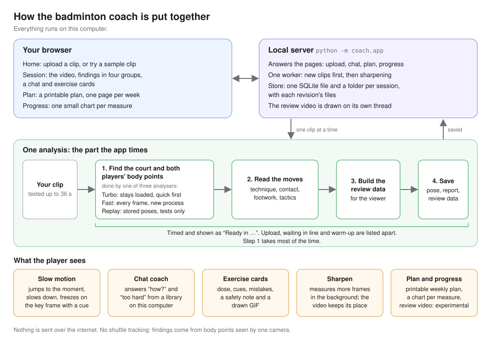

# Badminton coach

Upload a singles clip filmed from behind one baseline. The app shows each player what to work on (technique, hitting position, footwork and tactics), plays the moment in slow motion, answers "how?" in a chat, and suggests gym exercises, each with a drawn GIF. Everything runs on this computer. Nothing is sent over the internet.



## Status

| Part | Where it stands |
|---|---|
| About one second per clip | **Not met.** In the latest development speed check the whole analysis took 2.8 to 4.8 s per clip. The page shows the real time and never promises one second. |
| Coach chat | Works, but it is still being corrected after an independent test. Its check for pain and injury questions is not reliable yet: in that test one such question got exercise details. |
| Review video | Experimental. The continuous export now keeps every source frame and adds local Chinese neural narration, slow motion, freeze/zoom and a matching written report. This does not establish whole-product quality acceptance. |

All numbers here come from development runs on this computer, not from the final speed check.

## What it looks at

| Group | Examples |
|---|---|
| Technique | knee bend when ready, hip height (projected on the picture), lunge hip drop, foot width when ready, sideways trunk lean |
| Hitting position | how high you reach overhead, the hitting elbow, racket-hand speed |
| Footwork | the split-step hop around the opponent's swing and when it lands, first-step delay, small steps before a lunge, time back to your waiting spot, how much of your half you use |
| Tactics | where you wait when the opponent swings, how often you are nearer the net when they swing, time between swings in a rally |

What each player does well is shown too ("Doing well"), not only things to fix.

## What the player gets

- **Slow motion.** Click a finding. The video jumps to that moment, slows down and stops on the key frame with a short cue.
- **Ask the coach.** Buttons such as "What should I work on first?", "How do I fix it?", "Show me the moment" and "What exercises help?", or type your own question. Say it is too hard to get an easier version, or say what equipment you have.
- **Exercise cards.** Each card shows a drawn GIF of the movement, the dose, why it helps, how to do it, what to avoid and a safety note.
- **Sharpen.** Turbo first gives a quick result from some of the frames, then measures the key moments again in the background. Re-measured findings get a "Sharpened" badge and the video keeps its place. "Sharpen all" measures every frame. With Turbo and a clip up to 36 s, the button says "up to about 11 s" before you click; for longer clips it promises no time.
- **Plan.** "Make my plan" asks for 1 to 4 weeks, how much you train in the gym, and what equipment you have. The plan prints one page per week.
- **Progress.** One chart per measure across your sessions. The practice guide is a green band, and each measure says whether its latest reading is better, about the same or worse than the reading before. A reading the app could not take, or was not sure of at all, is not a point on the chart.
- **Names.** Name the near and far player so their progress stays together.
- **Review video (experimental).** Keeps the whole source clip in order, slows three separated supported observations, freezes and zooms the matching model-derived body points, and adds local Chinese neural narration. Downloads include the MP4, readable HTML analysis and JSON evidence/narration. A clip without three supported observations is refused explicitly, not filled with invented judgments. The old highlight renderer remains available for its existing tests.

## Complete narrated example

From the project folder, install the optional local narration runtime:

```powershell
$PY = ".\.venv\Scripts\python.exe"
& $PY -m pip install -r coach\requirements-narration.txt
New-Item -ItemType Directory -Force coach\models | Out-Null
curl.exe -L --fail https://github.com/k2-fsa/sherpa-onnx/releases/download/tts-models/vits-melo-tts-zh_en.tar.bz2 -o coach\models\vits-melo-tts-zh_en.tar.bz2
tar -xf coach\models\vits-melo-tts-zh_en.tar.bz2 -C coach\models
& $PY -B -m coach.complete_review sample-videos\04-china-open-ws-a.mp4 outputs\my-new-review
```

The output folder must be new. This command runs the existing dense Fast backend on the actual input (not Replay), then saves `pose.json`, `report.json`, `bundle.json`, `review.mp4`, `analysis.html`, `analysis.json`, `narration.txt`, `schedule.json`, `frame-map.json` and `run.json`. The planned schedule is saved before encoding. The full MP4 is decoded and its audio/video durations and frame counts are checked before success. The CPU ownership lock at `work\cpu.lock` covers analysis and export; a foreign lock is never removed. The app's exporter uses the same implementation and reports unavailable narration/models or insufficient observations instead of making a silent fallback.

The model download is public and free; inference, generated text and speech stay local. MeloTTS-Chinese is a neural voice via sherpa-onnx, not the Windows legacy speech voice. Its MIT licence is retained in the model directory. Chinese rendering requires Windows Microsoft YaHei. Slow motion repeats exact source frames at half speed rather than synthesizing intermediate body points. Freeze zoom uses that frame's model bounding box. `frame-map.json` binds every output frame to its source frame, and `analysis.json` binds every narration window to the same selected finding.

Selection is now conservative: only neighboring alternating player swings within the same camera shot support an exchange; no lead/tail padding extends it into pre-serve waits. No swings means unknown ready stance, not a static-pose fallback. Hip-drop cycles shorter than 0.30 s are not included in the body review. These are selection heuristics, not verified shuttle/rally labels. Posture and contact practice ranges remain visible as guides, but no longer create technique faults, strengths or corrective drills; pose confidence is not confidence in a personal norm. Their progress labels say higher/lower, not better/worse.

Clip 04 is a 30-second collage of four points, not a whole match. The complete example preserves that collage and its original cuts. It does not confirm contact, track the shuttle or validate medical, 3D or elite-technique conclusions. The broader six-clip speed/quality acceptance and chat-safety limits above still apply.

## Run it

### Vertical technique short (experimental)

This is a three-point technique lesson, not the approved player-named commentary reel. Its hook is fixed to `这一跨，学三个关键`. The following any-clip CLI has not yet been rechecked in the new reproduction environment. For the proved, match-specific commentary rebuild and its missing new-video steps, see [TikTok-style workflow status](../docs/tiktok-style-workflow.md).

With the same local voice installed, run:

```powershell
& .\.venv\Scripts\python.exe -B -m coach.short_review sample-videos\04-china-open-ws-a.mp4 outputs\my-new-short
```

The CLI runs fresh dense inference under the same ownership lock, then exports
`tiktok.mp4` (1080 x 1920, 30 fps, H.264/AAC, faststart), `cover.jpg`,
`captions.srt`, `post.txt`, `points.json`, `schedule.json`, `frame-map.json`,
`verification.json` and `run.json`. The destination must be new. Schedule and
per-output-frame source bindings are saved before encoding. `export_short` is
also callable with an existing pose document/report; it does not pretend that
this is fresh inference. This format is CLI-only; the existing app route still
exports the complete continuous review.

The three teaching excerpts follow `coaching_corpus/coaching_priorities.json`,
derived from 100 coaching transcripts, not 1,000. There are 17 known channel names
and 23 videos without channel metadata: 40 weighting groups, not 40 verified
channels. `describe_corpus.py` derives these counts from the hashed learner output;
the original ranking and scores remain unchanged. Only concepts
with local movement evidence can compete: clip 04 selects racket-leg footwork,
front-knee bend (with a balance-arm highlight), and knee re-extension into the next
move. They teach cues, not faults in professional technique. A sustained unilateral
knee/stride cycle complements hip-drop detection when perspective hides the hip
drop. The reported return time measures knee re-extension, not confirmed contact
to center-court recovery. Single-frame and single-cycle values have `n=1`.
Missing or unsupported points cause an explicit error. No contact timing,
split-step failure, force, medical or 3D judgment is made.

The short lasts 30-45 seconds, starts with a 1.2-second hook, caps each analysis
freeze at 3.5 seconds and paused time at 35%, and keeps each excerpt within one
observed movement context and camera shot. It uses exact source-frame slow motion
and real-keypoint leg/arm overlays, stride lines and knee arcs.
Captions use individually synthesized Chinese clauses and their measured
non-silent audio windows, not estimated reading speeds. Voice speed is 1.12.
All burned text stays outside the top 10%, bottom 20% and right 15% UI zones.
There is no background music. The post includes the named source author,
Commons/YouTube links, CC BY 3.0 link and edits. The Commons listing alone does
not establish upstream broadcast rights; verify those before publishing.
Other source footage must supply `--attribution-json FILE` with nonempty
`author`, `license`, `source_url` and `license_url` strings. It never inherits
this sample's authorship automatically.

### Editorial short (experimental)

This teaching format is separate from the match-specific commentary renderer. It does not generate a new title, professional shot calls, or the approved commentary style. The following any-clip CLI has not yet been rechecked in the new reproduction environment.

For a coach-led breakdown with separate legs, core, tactics and arms beats,
run:

```powershell
& .\.venv\Scripts\python.exe -B -m coach.editorial_short sample-videos\04-china-open-ws-a.mp4 outputs\my-editorial-short
```

This CLI-only format runs fresh Fast analysis under the same CPU ownership lock.
It recomputes the court homography, keeps each scene within one camera shot,
and creates `tiktok.mp4`, `cover.jpg`, captions, a post draft, `analysis.html`,
`analysis.json`, measured source/output frame maps and a hash-bound
`handoff.json`. The arm chapter highlights only the measured arm phase, and the
tactics mini-map occupies a separate gutter rather than covering the footage.
The readable cut moves once through the lunge, trunk return and court position,
shows the separate arm action once with an explicit rally-change label, then
holds a static four-line summary card instead of replaying the footage. The
closing card counts toward the still-frame share; it is not a source-video
freeze. Narration that does not fit its selected forward clip is rejected
rather than padded with repeated motion.
The spoken observations remain separate from general practice advice; no
contact, shuttle path, force, medical or 3D claim is inferred. This exporter
does not replace the earlier three-point short or add a new app export route.

### Three ranked moments from a full supplied clip

For a complete source-timeline scan that ranks three distinct moments, reuse pose
evidence only when the exact video hash, pose hash, all frame indices and
timestamps match their saved manifests:

```powershell
& .\.venv\Scripts\python.exe -B -m coach.whole_clip_review `
  sample-videos\04-china-open-ws-a.mp4 outputs\three-moment-review `
  --pose results\tiktok-coaching-editorial-20261103-v4\pose.json `
  --pose-points results\tiktok-coaching-editorial-20261103-v4\points.json `
  --pose-analysis results\tiktok-coaching-editorial-20261103-v4\analysis.json `
  --pose-handoff results\tiktok-coaching-editorial-20261103-v4\handoff.json
```

The output includes a Chinese narrated MP4, readable HTML, machine-readable
analysis, a candidate inventory by camera shot, narration, and a frame-by-frame
source map. Every candidate episode has 1–10 highlight, coaching-value and
evidence-quality ratings, a weighted combined rank (40%/35%/25%) and a reason.
These are editorial ratings produced by the analysis agent from the footage,
not human-reviewed judgments. Raw model scores are evidence notes, never skill
scores or ranking inputs. The readable report gives 2–4 brief, evidence-bound
analysis points per selected moment; raw JSON evidence stays collapsed by
default. The attack-and-dive view begins wide, then follows the near player;
the two-player exchange uses a shared court crop. Model overlays draw only
individual joints that meet the 0.70 score threshold and remain inside the
tracked player box; unmeasured frames have no pose overlay. Each moment slows
into its key frame, holds that still for two seconds with three short coaching
points, then continues forward once. Narration summarizes the visible sequence
and practice cue; the second moment's player positions and net displacements
are explicitly labeled as 2D court estimates.
Every selected interval must stay within one camera shot. The sample input is a
30-second, four-shot excerpt—not a whole match—and its Commons CC BY 3.0 source
label does not establish that upstream broadcast rights have been cleared.

Recheck the encoded file against the original footage and saved pose evidence:

```powershell
& .\.venv\Scripts\python.exe -B -m coach.verify_short outputs\my-new-short sample-videos\04-china-open-ws-a.mp4
```

This reproduces the measurements, checks cut/play support, compares ten decoded
output frames against their source/pose/caption bindings, and checks decoded
audio in every measured caption window. It does not replace listening or
independently validate coaching advice.

Handedness is explicit per player: sample attribution declares right/right for
clip 04, with image evidence. Use `--near-hand right --far-hand right` to override,
or declare `players.near.hand`/`players.far.hand` in source attribution. Missing
input means unknown: no guessed racket-side swings or arm-specific findings.
The speed-based wrist guess has been removed. The corpus generators are copied
beside the ranking for provenance; their input datasets remain outside this repo.
Chat also respects an unavailable finding already in focus: it says that reading
is missing rather than switching to a different finding. Descriptive posture
readings do not create a corrective plan or a personal fault.

Use the repo's Python environment (`.venv`, Python 3.12; see the quick start in the [main README](../README.md)). From the project folder:

```powershell
$PY = ".\.venv\Scripts\python.exe"
& $PY fast\prepare_cache.py    # once: prepares the Fast analyser's models
& $PY -m coach.app             # opens http://127.0.0.1:8765/ in your browser
```

Turbo fills its own model cache in `turbo\cache` the first time it starts, so the very first start can take longer.

| Option | What it does |
|---|---|
| `--port 8765` | The port. `0` picks any free port. |
| `--backend turbo` | `turbo` (default): stays loaded, gives a quick first result, then sharpens. `fast`: measures every frame, in a new process for each clip; slower; used by itself when Turbo is not installed. `replay`: reads stored body points for sample clips 01 to 05 and 08; for tests only, not a live analysis. |
| `--data-dir DIR` | Where sessions are kept (default: `data` in the project folder). |
| `--no-browser` | Do not open a browser window. |
| `--no-auto-refine` | Do not sharpen key moments by itself. "Sharpen all" still works. |

At start it prints the address, which analyser it uses, and the data folder. If the chat, plan or review video part is missing, it says "Not installed yet: …". The plan and review video buttons are then turned off, and the chat answers that it is not installed yet. The plan button also needs the chat, because the chat is what remembers a stop for pain. When the analyser is warm it prints "Analyser ready after … s of warm-up."

The home page opens before the analyser is warm. If another program already uses the port, the app stops at once with "Port 8765 is not free … Try --port 0 for any free port."

Your data stays in the data folder:

- `coach.db`: one SQLite file with your sessions, measures, findings, chat and plans.
- `sessions\<id>\`: your video, and for each revision (`r0`, `r1`, …) `pose.json`, `report.json`, `bundle.json` and any review video.

To delete one session with all its files, close the app and run (add `--data-dir DIR` if you chose one):

```powershell
& $PY -m coach.app delete <session id>
```

The first start after an update can rebuild the measures in `coach.db` from each session's saved `report.json`. This is needed because older versions stored a practice-guide value where nothing was measured. The rebuild either finishes or changes nothing. Your names, chat and plans stay. After it, older copies of the app refuse this data folder ("made by a newer version of the app"). If a session's `report.json` is missing or damaged, the app stops and names that session and file: put the file back, or delete that session with the command above, then start again.

## What "about one second" means

The goal: the app is already running and warm, the clip is up to 36 s long, and the time runs from the start of the analysis to the saved report. It is **not met yet**.

The page's "Ready in …" covers only the four steps in the picture. Upload, waiting in line and warm-up are listed apart as "Not counted in that time". Sharpening comes later and is timed on its own. Clips from 36 s up to 3 minutes are accepted, but the page says they take longer, and no time is promised for them.

Measured on this computer (AMD EPYC 7763, 8 cores and 16 threads, 64 GB, Windows 11, Python 3.12.10):

| What was timed | Time | Notes |
|---|---|---|
| Whole analysis of one clip, warm | 2.8 to 4.8 s | Turbo; clips 01 to 05 and 08, one run each, by the speed-check harness |
| Step 1: finding the body points | 2.6 to 4.5 s | most of the time above |
| Steps 2 to 4 | about 0.2 s | review data 16 to 29 ms; saving 38 to 48 ms |
| Cold: a brand-new process loads the models and analyses a 3 s clip | 1.9 s | after the one-time model preparation |
| From the start command to the home page | 0.8 s | a new, empty data folder; Python start-up included; two starts |
| Analyser warm-up after the app starts | 0.7 to 7.4 s | Turbo, in the five starts with a kept log: 0.7 s three times, 7.1 and 7.4 s once each; a start straight after the 7.1 s one took 0.7 s. Python start-up is not included |
| Sharpen all on clip 03 (36 s) | 10.5 s | from the click until the sharpened result was saved, 10.1 s of it finding body points; measured once on this one clip, so the button quotes it only with Turbo and for clips no longer and no bigger than this one |
| Automatic sharpening on clip 03 | 11.3 s | from the quick result until the sharpened one was saved, in one pass over every frame. The old way, 17 separate key moments, took 74 s, so when key moments cover half a clip of up to 36 s it now measures the whole clip at once |
| Review video | about 10 to 12 s per second of video | clip 03: 287 s for 29 s of video |
| Coach reply to "How do I fix it?" | 32 to 108 ms | live Turbo, idle or sharpening |
| From a click on a sample to the first useful screen | 1.0 to 1.5 s | with Replay, so no analysis is in it: this is the page's own speed |

## Run the tests

From the project folder, with `$PY` as above. The browser tests need Microsoft Edge and Node.js 22 or newer (tested with 24.20.0).

| What | Command |
|---|---|
| App tests (store, upload checks, queue, routes, timed runner) | `& $PY -m unittest discover -s coach\tests -t . -p "test_app_*.py"` |
| All coach tests | `& $PY -m unittest discover -s coach\tests -t .` |
| Browser test, whole flow (starts its own app with Replay and an empty data folder) | `node coach\web\tests\e2e.mjs` |
| Browser test of a running app, on one finished session. It uploads, renames and sharpens nothing, but its chat questions and the plan it makes are saved in that session. | `node coach\web\tests\e2e.mjs --url http://127.0.0.1:8765/ --session <id>` |
| Browser test of a running app with one clip it should refuse, such as a 3 minute black video (`tools\ffmpeg.exe -f lavfi -i color=black:s=1280x720:r=30 -t 180 -pix_fmt yuv420p black.mp4` makes one). It uploads the clip with the file picker, checks that the page and the server give the same plain message with no leftover note above it, and that the app still answers. | `node coach\web\tests\e2e.mjs --url http://127.0.0.1:8765/ --upload <video> --expect no_court` |
| Slow-motion viewer on its own | `node coach\web\tests\cdp.mjs` |
| Session page cards on their own, without a browser: a reading the clip did not give shows "not measured in this clip" and the practice guide, never a number | `node coach\web\tests\cards.mjs` |
| Session page of a refused clip, without a browser, on the saved state of the black-video check: the long-clip note shows while the clip is analysed and is gone once the app refuses it, and the app's message is shown unchanged | `node coach\web\tests\refusal.mjs` |
| Coach panel after a stop for pain, without a browser: no training buttons after the stop, after a question the app refused, after a reload or in a new tab, while another clip's chat keeps them | `node coach\web\tests\painstop.mjs` |
| Speed check for diagnosis: one warm process, a fresh copy of each test clip every run, and every run must take less than 1 s. It deletes each run's files after checking only that they exist, so it is not the acceptance table. Upload, waiting in line and warm-up are not in it. | `& $PY -m coach.app.bench_e2e --repeats 5 --json bench.json` |
| Speed-check harness, development mode | `& $PY -m turbo.accept dev --runner coach=coach.app.pipeline:E2ERunner --models-dir fast\weights --runs 1 --out <empty folder>` |

`e2e.mjs` saves screenshots and a summary to `work\C6\shots`; `cdp.mjs` saves its own to `work\C2\shots`; `cards.mjs`, `refusal.mjs` and `painstop.mjs` save nothing. All five exit with 1 when a step fails.

## Replay the evidence

To see the app without live analysis, run it on stored body points:

```powershell
& $PY -m coach.app --backend replay --data-dir "$env:TEMP\coach-replay"
```

The page then says "Replay of a stored pose file, not a live analysis". It knows only sample clips 01 to 05 and `08-china-open-ws-f`.

The measurements behind this README stayed in the lab notebook (`obj2\work\C6`), which is not part of this repo:

| File | What it holds |
|---|---|
| `iterations.tsv` | each change tried, with before and after numbers, and whether it was kept |
| `accept-dev-e2e\` | the development speed check (`acceptance.json` and one file per run) |
| `sharpen-measure.json`, `sharpen-measure-auto.json` | "Sharpen all" and automatic sharpening on clip 03 |
| `export-check.json` | review video timing |
| `first-useful-*.json` | time from a click to the first useful screen, with Replay |
| `how-probe-*.json` | coach reply times |
| `fresh-start*.json`, `fresh-start*.log` | starts from a new, empty data folder |
| `black-check\` | the 3 minute black video and how it was made |
| `shots\` | browser test screenshots and summaries |
| `contract-requests.md` | problems reported to the other parts, and how each was settled |

## What it cannot do

- It sees one camera in 2D. Angles are not 3D, and hip height is projected on the picture, not a measured centre of mass.
- It does not track the shuttle. Swings are arm swings it saw, not confirmed shots, and tactics come from where the players stand and move.
- Targets are practice guides, not norms tested on amateur players. The app says this too.
- It is not medical advice. If you mention pain or injury, the coach is meant to suggest seeing a professional instead of giving exercises, but that check is not reliable yet (see Status). Once the coach has stopped for pain, that clip's chat stays stopped, even after a reload or in a new tab: no exercises, no training buttons and no new plan for that clip. This also holds when another tab records the stop while a reply or plan is still being made: that reply is not kept and the coach answers again knowing about the stop, and that plan is refused. It can still say what you did well, what it cannot measure, and show a moment. Earlier messages and saved plans are kept.
- It needs a full court filmed by a fixed camera behind one baseline, with two players (singles). Clip 11, a high side view of a hall with several courts, is refused with "I could not find the court in this video".
- It was tested on clips of up to 36 s at 1080p and 30 frames a second. Clips longer than 3 minutes and videos wider than 3276 pixels are refused.
- Body points are estimates. When the app is unsure, it says so under "Worth knowing". When it could not take a reading at all, the finding says "not measured in this clip" and shows no number.

## Licences and credits

Sample clips are in `sample-videos\`, with full details in the `*attribution.json` files there. No endorsement by the players, venues, tournaments, BWF or creators is implied.

| Clips | Source | Licence | Changes |
|---|---|---|---|
| 01 to 03 | "2026 YONEX Arise International Challenge \| Day 3 - Court 1 \| Quarter Finals" by Arise Sports Complex ([YouTube](https://www.youtube.com/watch?v=M4vUm6wl6pc)) | marked "Creative Commons Attribution license (reuse allowed)" on YouTube, which links to [CC BY 4.0](https://creativecommons.org/licenses/by/4.0/) | recorded from browser playback, audio removed, trimmed, H.264 at 30 fps |
| 04 to 10 | "Wang Zhiyi triumph in all-Chinese China Open finals I China Open 2025" by Badminton Sphere ([Wikimedia Commons](https://commons.wikimedia.org/wiki/File:Wang_Zhiyi_triumph_in_all-Chinese_China_Open_finals_I_China_Open_2025.webm)) | CC BY 3.0, as listed on Wikimedia Commons | 30 s trims, audio removed, H.264 at 30 fps |
| 11 | "Badmington Competition EuroGames 2 2023 in Wankdork, Bern" by Hyruspex ([Wikimedia Commons](https://commons.wikimedia.org/wiki/File:Badmington_Competition_EuroGames_2_2023_in_Wankdork,_Bern.webm)) | CC BY-SA 4.0 | 40 to 70 s of the source, audio removed, scaled to square pixels, H.264 at 30 fps |

Models:

- Player finding: YOLO26 (`yolo26n`, `yolo26s`) by Ultralytics, offered under AGPL-3.0 or the Ultralytics Enterprise licence. Read [Ultralytics licensing](https://www.ultralytics.com/license) before sharing the app or the model files.
- Body points: RTMPose-t and RTMPose-s from OpenMMLab MMPose and RTMLib (Apache-2.0), fine-tuned in this project. How they were trained is in `fast\runs\step2-training-provenance.json`.

The 18 exercise GIFs are original drawings made by `coach\exercises\render.py`. No outside images are used.

## Whole-reel tactics table (experimental)

From the project folder, run the stage-1 per-hit table against the China Open reel (`python scripts\get_footage.py --no-cut` downloads it):

```powershell
$PY = ".\.venv\Scripts\python.exe"
& $PY -B scripts\with_lock.py "tactics engine" -- `
  .\.venv\Scripts\python.exe -B -m coach.tactics `
  footage\china-open-2025-ws-final.webm `
  outputs\tactics-engine-new `
  --segments sample-videos\china-open-segments.json `
  --states sample-videos\china-open-score-states.json `
  --ffmpeg tools\ffmpeg.exe `
  --pose-python .\.venv\Scripts\python.exe `
  --player-attribution sample-videos\china-open-source-attribution.json
```

The destination must be new. `--player-attribution` is optional; without matching source evidence, both hands stay unknown. To reanalyse a saved pose cache without inference, pass its `pose_cache` directory with `--pose-cache`, choosing a new output directory. Pose-cache chunks are storage boundaries only: adjacent chunks are joined within each approved camera interval before rally selection, while detected camera cuts remain boundaries.

Pose peaks describe a swing phase, not shuttle contact. Nearby same-player peaks in one camera shot are retained as a single phase group. A contact-time estimate and hitter are reported only when one audio click falls unambiguously inside one measured phase; the audio click alone never creates a hitter, and no alternation is fabricated. Unconfirmed pose observations remain in `hits.json` with `contact_time_s: null`, a separate pose-event estimate, and no contact-specific shot, height, position, or landing-zone conclusion. Handedness is read only from explicit source attribution; the China Open attribution file includes right-hand evidence for the near/far players in clip 04. There is no shuttle tracking: even an audio-supported contact remains an estimate. Score changes and pose/audio events are evidence, not ground-truth rally labels. The output is a 2D analysis of an edited highlights reel, not a complete match or a coaching verdict; no hidden evaluation labels are used.
