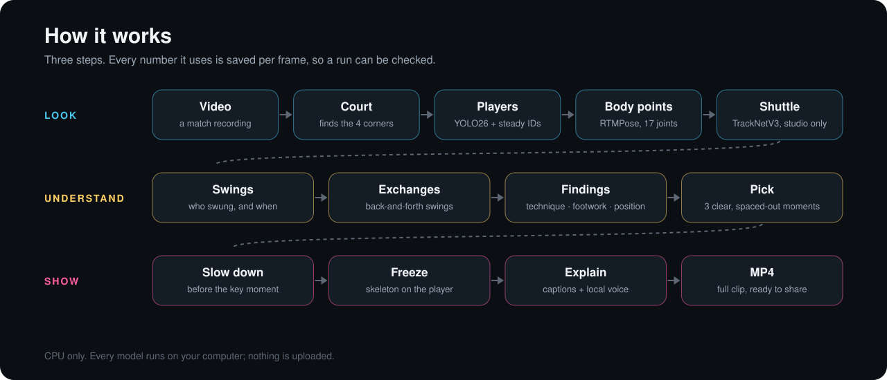

# How it works

Three steps. Every step writes its numbers to disk per frame, so any sentence in a review can be traced to the frame, the player and the joints it came from.

## 1. Look

**Court.** [`fast/court.py`](../fast/court.py) finds the white court lines in a fixed camera view filmed from behind one baseline. It tries pairs of lines as known court lines, projects the whole standard court, and keeps the fit that lands most of it on white pixels. The result is the four outer corners, which turn picture positions into metres on court.

**Players.** [`fast/detect.py`](../fast/detect.py) runs a YOLO26 person detector (OpenVINO, CPU) on the area around the court. It runs at the start of each stretch of frames and every few frames after that. In between, each player is followed with a box made from their previous skeleton. The two people who move the most become the near and far player, using which half of the court their feet are in. Officials who stand still outside the lines are dropped.

**Body points.** [`fast/pose.py`](../fast/pose.py) runs RTMPose on each player crop and returns 17 joints (COCO order) with a confidence for each. The model in [`fast/weights/`](../fast/weights/) was fine-tuned on badminton crops labelled by bigger models ([`train/`](../train/)). Points are mapped back to the original video frame, so the skeleton sits on the player. [`fast/smooth.py`](../fast/smooth.py) averages each joint with its neighbouring frames, but skips a neighbour that is missing, unsure, or far away, so real fast moves are not blurred.

**Shuttle (studio only).** [`studio/shuttle/`](../studio/shuttle/) runs TrackNetV3 to find the shuttle in each frame. The app does not use it yet.

## 2. Understand

**Swings.** [`coach/events.py`](../coach/events.py) measures the racket hand's speed relative to the shoulders. A swing starts and ends where that speed crosses 30% of its peak. A swing is an arm movement the camera saw, not a confirmed hit.

**Exchanges.** [`coach/play_state.py`](../coach/play_state.py) marks time as "in play" only where the two players swing in turn, or where a lunge is seen. It is not rally detection from the shuttle, so quiet time before the first swing is "unknown", not "no play".

**Findings.** The app turns joints and swings into findings in four groups: technique (knee bend, lunge hip drop, stance width), hitting position (reach, elbow, hand speed), footwork (split step, first step, getting back) and where you wait. Angles are measured on the flat picture, so they are called *projected* angles. They are not 3D joint angles.

**Pick.** [`coach/complete_review.py`](../coach/complete_review.py) picks three moments from the findings with a fixed rule: prefer lunge depth, then arm extension, then hand speed, then knee bend; take the most confident; keep moments at least 2 s apart; and alternate players. If it cannot find three, it says so and stops. It never fills the gap with a made-up moment.

An earlier prototype, [`coach/whole_clip_review.py`](../coach/whole_clip_review.py), combined an *excitement* score, a *worth learning from* score and a *how clearly we see it* score (0.40 / 0.35 / 0.25). Its scores were set by hand for one clip, so it is not automatic. Making that automatic is on the [roadmap](roadmap.md).

## 3. Show

**Slow down, freeze, zoom.** The review keeps every source frame in order. Around each picked moment it repeats real frames at half speed (it never invents in-between poses), then freezes on the key frame and zooms to that frame's player box with the skeleton drawn from the saved joints.

**Explain.** Captions and narration are written from the picked finding's own numbers. The voice is MeloTTS-Chinese running locally through sherpa-onnx.

**Check.** Before it reports success, the review decodes the finished MP4 and checks its length, audio and frame count. `frame-map.json` ties every output frame to its source frame.

## Short reels (studio)

The vertical TikTok-style reels in [`results/`](../results/) were made with the studio tools in [`studio/`](../studio/): TrackNetV3 for the shuttle, a local neural voice (Kokoro for the technical commentary reel), and a script written for each reel from the detected positions and frame review. Each script lists the claims it makes and how each was checked. These reels are records. They cannot be re-made from a fresh clone yet; see [reproducibility](reproducibility.md).

## Limits

- One fixed camera behind a baseline. Side views and moving cameras are not supported.
- Singles only.
- 2D only. No 3D angles, forces, or muscle effort.
- It does not confirm when the racket touches the shuttle.
