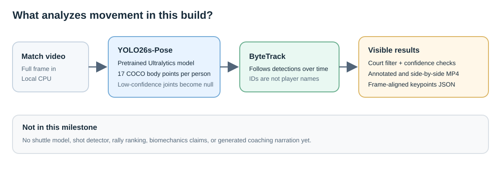

# AI Badminton Coach — Milestone 1

> History. This is the first milestone's write-up. The replay acceptance and `verify_final.py` need run folders and comparison videos (about 45 MB) that are not published. See [reproducibility](reproducibility.md).

This standalone Windows program runs a real pretrained pose model locally. It
detects people, follows them with ByteTrack, and draws model-detected body
points on the original video.



## Run it

Open PowerShell in this folder:

```powershell
$python = "$env:LOCALAPPDATA\Programs\Python\Python312\python.exe"
& $python -m venv .venv
.\.venv\Scripts\Activate.ps1
python -m pip install --upgrade pip
python -m pip install -r requirements.txt
python -m badminton_coach .\sample-videos\01-singles-rally.mp4
```

On the first run, Ultralytics downloads `yolo26s-pose.pt`. Internet access is
needed for the Python packages and that pretrained checkpoint. The video
inference itself runs on the CPU.

The default input size is 1280 pixels so the far-side player has more detail.
That is slower than the smaller 640-pixel setting; use `--imgsz 640` or
`--imgsz 960` when speed matters more than distant-player detail.

The first window lets you pick the court: click four points around its edges,
leaving a little extra room for players who lunge. Choose them in order around
the court, press **Enter**, and the analysis begins. Use **Backspace** to undo
one point, **R** to reset, or **Esc** to cancel. People count as part of the
court only when their detected feet fall inside the selected shape. The
detector still sees the full frame so it does not cut off a player's head or
feet.

Watch the single terminal line for frame progress and estimated time left. A
new results folder appears under `outputs`; it never silently overwrites a
previous run.

## What you get

- `annotated.mp4` — continuous source video with each tracked person's
  detected body points drawn as a bold, dark-outlined skeleton on the matching
  frames. A point the model was unsure about is left out, and a limb is drawn
  only when both of its end points were detected.
- `side-by-side.mp4` — the original frame on the left and that same annotated
  frame on the right.
- `keypoints.json` — one record per input frame, timestamped from its frame
  number and source frame rate. Each person has 17 COCO body points in original
  video pixels. A low-confidence or missed point is `null`, not guessed. Both
  videos are drawn from this file, so they cannot disagree with it.
- `summary.json` — time taken, how often each track was seen, and a reminder
  that tracking IDs are short-lived labels, not proof of identity.

Skeleton colors are a drawing aid, not an identity. People who are on screen
together always get different colors (magenta, yellow, cyan, orange, violet).
A track that restarts under a new ID may reuse a color, so a shared color is
not proof it is the same person. The `ID n` label next to each person is the
raw ByteTrack ID.

The clips supplied here are 1080p, silent, fixed-view singles footage saved
from licensed stream playback. Other courts and people remain visible in the
image. Pick the center court. These test videos are not original ground truth,
are not 60-fps slow-motion sources, and are not proof the model is accurate.
No pose model result is hard-coded.

## Redraw the videos without re-running detection

Detection is the slow part, and the videos are drawn from `keypoints.json`
alone. To redraw them from a finished run:

```powershell
python -m badminton_coach.render .\outputs\<run-folder> .\sample-videos\01-singles-rally.mp4
```

The command first checks that the video matches the JSON (size, frame rate and
frame count). It draws into a temporary folder, then replaces `annotated.mp4`
and `side-by-side.mp4` in that run folder. `keypoints.json` and `summary.json`
are not changed, and a failed draw leaves the old videos in place. If a video
player has one of the files open, close it and run the command again.

## What the first real run showed

On the included 26-second men's clip, detection took 317 seconds for 780
frames at the default 1280 input size on this CPU. That run came from an
earlier version that drew while it detected; redrawing both videos from the
saved `keypoints.json` took 75.5 seconds. In the current version the time in
`summary.json` covers detection, drawing and encoding.

Per frame, exactly two in-court people were detected in 631 frames, one in
121 frames, and three in 28 frames. Using a rough size rule (a box shorter than
195 pixels counts as the far-side player), both a near and a far player were
detected in 606 frames (78%), only the near player in 104 (13%), and only the
far player in 70 (9%). For example, at 22 seconds the dark-shirted far player
is visible at the net but gets no skeleton because the detector did not find
him. At 15 seconds, both players' overlays were visibly aligned. Track IDs can
also split. These are observations from one video, not general accuracy
claims.

## The boundary of this milestone

This is a local test program, not the finished coaching app. It does not track
the shuttle, split or rank rallies, make movement or injury claims, add
narration, or select highlights. ByteTrack IDs can change after a long gap or
crossing. The JSON reports those raw per-run IDs rather than pretending to
recognize a person.

The implementation pins Ultralytics and uses YOLO26s-Pose. Ultralytics is
offered under AGPL-3.0 or a commercial Enterprise license; personal
experimentation is covered by the community option, while private/commercial
use or redistribution may require a different license. Review
[Ultralytics licensing](https://www.ultralytics.com/license) before changing
the use or sharing the application or model weights. The input-video
attribution and license notes are in `sample-videos\source-attribution.json`.

## Troubleshooting

- **No window opens:** use a normal Windows desktop session; the court picker
  needs a display.
- **H.264 encoder unavailable:** install FFmpeg and make `ffmpeg` and
  `ffprobe` available on `PATH`, or set `BADMINTON_FFMPEG` and
  `BADMINTON_FFPROBE` to their executable paths.
- **Slow processing:** the first inference loads and initializes the model.
  This version favors a truthful full-frame CPU result over real-time
  processing. The progress line reports observed speed; published model speed
  numbers are not estimates for this video.
- **Skeleton hard to see:** videos made by an older version used thin lines.
  Redraw them with the command above.
- **Wrong or missing poses:** check that the court selection has a small
  margin and covers the players' feet. Low-confidence joints are intentionally
  hidden. A person who is clearly visible but has no skeleton was missed by the
  detector in that frame, most often the small far-side player; the default
  `--imgsz 1280` helps. Inspect the original alongside `side-by-side.mp4`.

Run the automated checks without downloading model weights. They cover the JSON
format, the overlay's visibility and color rules, and that a redrawn skeleton
lands on the right frame and pixel. The render checks are skipped when FFmpeg
is missing:

```powershell
python -m unittest discover -s tests -v
```


## Fast pipeline (`fast/`) and acceptance evidence

**The current frozen candidate passes all 50 measured processes and the separate clip-01 consensus
check:** 25 development runs, 20 additional clip-03 stress runs, and five runs on previously unseen
clip 08. Every process saved
a complete JSON in under 10 s and met the baseline's PCK05, PCK10 and player-found rate against the same
model reference. The earlier independent-reference regression is recovered: PCK05 is 18,779/19,017
versus baseline 18,776/19,017; PCK10 is 18,916/19,017 versus 18,906/19,017. **This remains model-reference
agreement, not proof of human-labelled accuracy.** The narrowest measured timing margin is only
0.071221 s; these observations are not a guarantee under arbitrary host load.

Run from the repo root:

```powershell
.\.venv\Scripts\python.exe fast\prepare_cache.py
.\.venv\Scripts\python.exe fast\pipeline.py sample-videos\08-china-open-ws-f.mp4 fast\runs\out.json
```

The ordinary defaults are the measured configuration; there is no `POSE_CFG` override. Eight segment
workers use YOLO26s at segment starts, YOLO26n every 16 frames, pose-guided tracking, and automatic court
finding. The distilled RTMPose-t (`rtmpose-t-ft3.onnx`) probes fresh crops. A mean joint confidence below
1.0 immediately reruns the **same crop in the same frame** with RTMPose-s (`rtmpose-s-ft1.onnx`), then
uses s for the next eight fresh-inference opportunities on that track. Even when the mean is high, any
joint confidence below .65 triggers the same-frame retry, but does not hold subsequent inferences on s.
This reallocates the strong-model budget from blanket mean-confidence holding to hidden weak joints.
Low-change reuse is separate:
compare the current image at the last inferred crop, reuse only below threshold 8, and refresh within
16 frames. Not every emitted skeleton is a new inference. JSON `processing_counts` separates fresh
person crops for both models, inference requests, fallback crops and reused rows, including follower work.
Clip 08 has 924 fresh s crops, 891 fresh t crops, 322 t-to-s fallbacks (241 weak-joint-only) and 307 reused
rows. Fallbacks are included in both models' fresh-crop counts, not additional output frames.

**Setup and timer.** `prepare_cache.py` compiles seven graphs without reading a video or pose JSON and
atomically writes `fast/cache/prepared-models.zip`. The uncompressed archive is opened once per process;
source-model hashes, preprocessing/configuration, OpenVINO version, CPU identity and each graph's hash
are checked before import. Prepare it again on a different runtime/host or after changing models. The
prepared bundle is for the default configuration; mismatched custom configurations fail explicitly.
Without a bundle, the earlier IR/OpenVINO cache path remains available.

The timer starts before launching a fresh Python process and ends after successful exit with saved JSON.
It includes imports, graph reading/checking/import, decode, automatic court finding, inference/tracking
and JSON saving. It excludes dependency installation/downloads, one-time graph preparation, benchmark
setup/probing and MP4 overlay rendering. No cached pose JSON is an input. Do not run competing
inference/render tasks during timings. Rendering is a separate, untimed command:

```powershell
.\.venv\Scripts\python.exe fast\render.py sample-videos\08-china-open-ws-f.mp4 `
  fast\runs\step4-rebalanced-holdout08\outputs\08-r1.json fast\runs\clip08\replay-comparison.mp4 `
  --vs fast\runs\baseline-08.json --vs-label "Baseline: player-finder + RTMPose" `
  --label "Final: analysis-only 8.50s median (5 runs)"
```

The final `fast/runs/clip08/baseline-vs-final-08-corrected.mp4` is 900 frames, 30 s, 1920x540,
6,324,341 bytes (under 64 MiB), fully decoded after rendering. The final time is the five-run
fresh-process median, excluding overlay rendering. The baseline label deliberately has no runtime:
its single internal measurement is not a matched speed comparison. No speedup ratio is claimed.
`fast/runs/clip08/render-manifest.json` binds the MP4 to the exact accepted `08-r1.json`,
baseline JSON and source-video hashes. No new inference was performed for either render.
The original video and `render-manifest-original-labels.json` remain historical artefacts.

**Scope and provenance.** Supported cameras are fixed behind a baseline, showing singles and visible
court lines. Panning/handheld/side cameras, doubles and missing court lines are not supported. Dev clips
01-05 are respectively 26/30/36/30/30 s (780/900/1080/900/900 frames), all 1080p30. Clips 04/05 were used
for court/role/cut tuning, so they are not holdouts even though they were not training data.
Clip 06 (source seconds 70-100) is **historical holdout evidence for the original revision only**.
Clip 07 (180-210) is **historical for the step-2 revision**, not a current holdout, and was not used for
later training or tuning. For current clip 08, source seconds 240-270 were reserved before viewing.
That window was rejected solely because its first approximately six seconds contain a side-camera replay.
The replacement 250-280 window was inspected for camera suitability only; the fixed-baseline view was
accepted before reference generation or scoring. Both contact sheets and the rejected unscored clip are
retained. Current code/both pose models were frozen before either window was created/viewed.
`fast/runs/clip08/provenance.json` records source, trim, hashes, freeze and camera-only selection.
There was no tuning after clip 08 scores.
The supplied source credit/license is preserved locally in
[sample-videos/china-open-source-attribution.json](../sample-videos/china-open-source-attribution.json):
"Wang Zhiyi triumph in all-Chinese China Open finals I China Open 2025", Wikimedia Commons,
CC BY 3.0 as listed there. The clips are trimmed, audio removed, converted to H.264 at 30 fps;
no image crop was made.

The original s checkpoint is intact (`train/ft1.json`). Tiny was fine-tuned in two stages (8 then 12
epochs, lr 2e-5, batch 32) using existing teacher-labelled `train/lab-ms-0.npz` and `lab-ws-0.npz`
(2,995 crops); `lab-ms-102.npz` is the separate validation window (540 crops). No new labelling pass,
China Open training, or training on 06/07/08 was used. Teachers were RTMPose-x-halpe26 and
RTMW-x-wholebody, each original/flipped, not the body7 judge. Exact training arguments, seeds, logs,
data/checkpoint/model hashes are in `fast/runs/step2-training-provenance.json`.
An additional four-epoch arm-weighted tiny fine-tune was tested and rejected; its weights and isolated
cache are retained under `step4-arms-freeze/` and `step4-arms-assets/`. The selected model is still ft3,
not the rejected ft4 or either learned risk selector.

### Replaying acceptance

These complete commands use existing frozen judge/baseline files. Run from the project root.
Output directories must be new/empty; the harness refuses to overwrite results. Graph preparation above
is a prerequisite. Replaying clip 08 verifies this frozen candidate, not another untouched evaluation.

```powershell
.\.venv\Scripts\python.exe fast\acceptance.py run --suite replay-dev `
  --out fast\runs\replay-dev --runs 5 `
  --expect-pipeline-sha EEE0C7C6C6E55C54D3EFB65B508CC5EC59F9C29ACB876D2CFF2CC7C84411DFD9 `
  --expect-pose-sha 5538151BB67352E23E4D8EBA85FE072542407599A0ECEEF4963B855C2992D9BD `
  --clip "01|sample-videos\01-singles-rally.mp4|fast\runs\judge-01.json|fast\runs\baseline-01.json" `
  --clip "02|sample-videos\02-singles-dive.mp4|fast\runs\judge-02.json|fast\runs\baseline-02.json" `
  --clip "03|sample-videos\03-womens-singles-rally.mp4|fast\runs\judge-03.json|fast\runs\baseline-03.json" `
  --clip "04|sample-videos\04-china-open-ws-a.mp4|fast\runs\judge-04.json|fast\runs\baseline-04.json" `
  --clip "05|sample-videos\05-china-open-ws-b.mp4|fast\runs\judge-05.json|fast\runs\baseline-05.json"
.\.venv\Scripts\python.exe fast\acceptance.py run --suite replay-stress03 `
  --out fast\runs\replay-stress03 --runs 20 `
  --expect-pipeline-sha EEE0C7C6C6E55C54D3EFB65B508CC5EC59F9C29ACB876D2CFF2CC7C84411DFD9 `
  --clip "03stress|sample-videos\03-womens-singles-rally.mp4|fast\runs\judge-03.json|fast\runs\baseline-03.json"
.\.venv\Scripts\python.exe fast\acceptance.py run --suite replay-holdout08 `
  --out fast\runs\replay-holdout08 --runs 5 `
  --expect-pipeline-sha EEE0C7C6C6E55C54D3EFB65B508CC5EC59F9C29ACB876D2CFF2CC7C84411DFD9 `
  --clip "08|sample-videos\08-china-open-ws-f.mp4|fast\runs\judge-08.json|fast\runs\baseline-08.json"
.\.venv\Scripts\python.exe fast\acceptance.py post fast\runs\replay-dev\acceptance.json `
  -o fast\runs\replay-dev-post.json --consensus-clip 01
.\.venv\Scripts\python.exe fast\acceptance.py merge `
  fast\runs\replay-dev\acceptance.json fast\runs\replay-stress03\acceptance.json `
  fast\runs\replay-holdout08\acceptance.json -o fast\runs\replay-acceptance.json
```

To recheck the retained evidence without running inference again (choose a new output file):

```powershell
.\.venv\Scripts\python.exe fast\verify_final.py `
  --freeze fast\runs\step4-freeze-rebalanced\freeze.json `
  --suite fast\runs\step4-rebalanced-dev\acceptance.json `
    fast\runs\step4-rebalanced-stress03\acceptance.json `
    fast\runs\step4-rebalanced-holdout08\acceptance.json `
  --render fast\runs\clip08\render-manifest.json --out fast\runs\replay-verification.json
```

This recomputes scores from all saved coordinates, checks output integrity and frozen hashes,
and fully decodes the hash-bound comparison video. It checks recorded process times, not new timings.

Every process counts, including errors and slow runs. Each persisted output is checked for complete
frame counts, indexes/timestamps, dimensions, unique IDs, valid boxes and 17 finite-or-null joint entries.
The harness retains outputs/stdout/stderr, precise wall nanoseconds, commands, CPU/load, versions,
code/input/reference/output hashes, both pose-model/detector hashes and before/after cache state.
The primary quality gate compares integer hit/total counts for PCK05, PCK10 and found rate against
baseline-vs-the-same-judge on every output. The real clip-01 consensus stays separate and is also required
to pass for current suites. Merging rejects mixed revisions and duplicate run IDs, requires at least
five runs per clip, and recomputes speed/primary-quality/secondary-quality/freeze gates.

### Frozen results and limits

Entry point: `fast/runs/step4-final/acceptance.json`; source/config/model/cache freeze:
`fast/runs/step4-freeze-rebalanced/freeze.json`. Suite reports retain every individual result and exact counts.
Host: AMD EPYC 7763, 16 logical / 8 exposed physical cores, 64 GiB RAM, Windows 11; runtime versions
and per-run competing load are recorded rather than assumed idle.

| Clip/suite | Runs | Wall seconds min / median / max | Primary gate |
|---|---:|---|---|
| dev 01 | 5 | 7.2578441 / 7.3734835 / 7.4073381 | pass |
| dev 02 | 5 | 8.6596044 / 8.7187914 / 8.7273458 | pass |
| dev 03 | 5 | 9.2400924 / 9.3008419 / 9.8663490 | pass |
| dev 04 | 5 | 7.8356834 / 8.0039980 / 8.0907248 | pass |
| dev 05 | 5 | 8.3307719 / 8.3698903 / 8.5030673 | pass |
| additional dev 03 stress | 20 | 9.1745707 / 9.3528224 / 9.9287790 | pass |
| new holdout 08 | 5 | 8.1489926 / 8.5025336 / 9.6644320 | pass |

Primary judge agreement on 08: final/baseline PCK05 .9395/.9373, PCK10 .9701/.9550,
player-found .9950/.9683. This judge is YOLOX-x + RTMPose-x, **not human ground truth**;
its `joints`, `sapiens` and `posewarper` slots are duplicated aliases, not three independent references.
The real earlier clip-01 Sapiens/PoseWarper predictions are instead in `fast/reference/consensus.json`.
Against that separate reference, all five current clip-01 runs have PCK05 18,779/19,017, versus
baseline 18,776/19,017 (three more matches); PCK10 is 18,916/19,017 versus 18,906/19,017.
See `fast/runs/step4-rebalanced-dev/acceptance.json` (`secondary_consensus`) for full exact counts,
and `step4-rebalanced-dev-post.json` for the separate summary. The earlier step-2 checkpoint
(`fast/runs/step2-final/acceptance.json`) passed the primary gate but had PCK05 18,759/19,017 versus
18,776/19,017. That known historical regression is retained, not relabelled as a pass.
Passing these checks on this small collection does not establish universally equal or human-labelled accuracy.

Historical failures were not deleted or merged into the new revision. `fast/runs/acceptance-dev/`
retains original 03-r1 10.4553057 s and 03-r5 10.202754 s. The cascade's first eager/lazy cache revisions
each failed one run (`step2-acceptance-dev/`: 10.9697676 s; `step2-final-dev/`: 11.6812174 s).
Serial loading was rejected after two further failures (`step2-serial-dev/`: 12.1531619 and 10.9085346 s).
Diagnostics localized a roughly four-second detector-file-open stall, even before explicit graph import;
its underlying OS/filter cause is unproven. No antivirus/host-policy changes or resident inference
service were used. A single-open archive is the retained storage change, not a claim that compilation
alone was the cause. The IR/no-blob control (`step2-ir-control/`) gave no clear end-to-end advantage.
Ordinary processing is still inference-heavy; prior stream/segment/reuse sweeps and the measured
0.0284 s total cyclic-GC pause did not justify further changes.

### Earlier bounded follow-ups (not promoted)

Before the current budget reallocation, a dev-only retry when any tiny joint
confidence was below .65 recovered the independent clip-01 deficit: PCK05 18,781/19,017 versus baseline
18,776/19,017, and PCK10 18,916/19,017 versus 18,906/19,017. It passed all 25 development runs
(`fast/runs/step3-tail-dev/acceptance.json`), but failed two of 20 additional clip-03 stress runs:
10.1461927 and 10.355353 s (`step3-tail-stress03/acceptance.json`). Those failures count; the candidate
was not promoted. An isolated weak joint retried only the current crop, not eight subsequent inferences.

A depth-three risk tree was then trained only on existing teacher-labelled training windows; the
separate original validation window was not fitted. It selected 13/70 validation tail crops, retaining
two of the three direct extra joint matches, but dev-01 consensus PCK05 was still only 18,774/19,017
(below baseline). A confidence-only tree selected 39/70 validation crops with zero net direct gain
and also failed the dev-01 secondary requirement. Neither selector is loaded by the normal pipeline.
Training parameters/data hashes, predictions and selector assets remain in
`fast/runs/step3-risk-training/`; screens are `step3-risk-screen/` and
`step3-risk-confidence-screen/`. These are unsuccessful bounded experiments, not acceptance passes.
`fast/runs/step3-outcome.json` links the evidence and records restoration of every frozen production
code/model/archive hash at that earlier handoff. Its source recovery field links the exact immutable
rejected candidate snapshot; the live diagnostic script subsequently evolved.
Clip 07 was not used for tuning or training. Shorter strong holds, wrist-only/temporal-tail retries,
replacing the segment-start detector with tiny, and the arm-focused fine-tune did not resolve both gates.
Those rejected outputs remain in `fast/runs/step4-*/`; the selected change is instead the 1.0 mean
threshold plus .65 minimum-joint rule, using the original ft3 model. No selector asset or training
library is loaded in the normal processing command.
