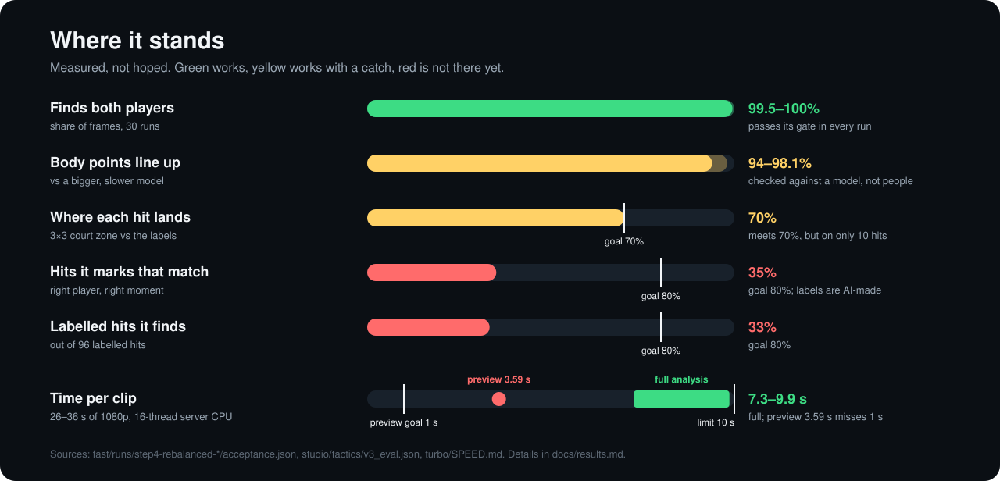

# Results

Every number on the front page, where it comes from, and what it does **not** show.

**Machine.** All timings were measured on a Windows 11 virtual machine with an AMD EPYC 7763 (16 logical CPUs) and 64 GB RAM. No GPU. It has **not** been timed on a MacBook.

**Judge.** "Accuracy" for players and body points means agreement with a bigger, slower model (YOLOX-x + RTMPose-x), not with people. A score here can be high and the bigger model can still be wrong.

## Players and body points

Source: [`fast/runs/step4-rebalanced-dev/acceptance.json`](../fast/runs/step4-rebalanced-dev/acceptance.json) and [`fast/runs/step4-rebalanced-holdout08/acceptance.json`](../fast/runs/step4-rebalanced-holdout08/acceptance.json), keys `accuracy_by_clip`, `timing_by_clip` and `clips.*.baseline_vs_judge`.

Each clip was run 5 times as a fresh process. The rule: on every clip, every run must match or beat the older, slower setup ("baseline") on players found and on body points. All 30 runs passed.

| Clip | Length | Players found | Body points (5%) | Baseline: found / body points | Time per run |
|---|---|---|---|---|---|
| 01 | 26 s | 100% | 98.1% | 99.4% / 97.5% | 7.26–7.41 s |
| 02 | 30 s | 99.5% | 97.6% | 97.7% / 96.2% | 8.66–8.73 s |
| 03 | 36 s | 99.9% | 97.4% | 99.6% / 97.3% | 9.24–9.87 s |
| 04 | 30 s | 100% | 95.3% | 95.5% / 92.8% | 7.84–8.09 s |
| 05 | 30 s | 100% | 94.4% | 95.2% / 91.6% | 8.33–8.50 s |
| 08, held out | 30 s | 99.5% | 94.0% | 96.8% / 93.7% | 8.15–9.66 s |

- **Players found**: share of frames where each of the two players was found.
- **Body points (5%)**: share of joints within 5% of the player's height of the judge's joint (PCK@0.05). Missing joints count as misses.
- **Held out**: clip 08 was not used while tuning.
- The five runs per clip gave the same accuracy each time; only the time changed.

**What it does not show.** Clips 01–03 come from one court stream of one tournament (2026 Arise International Challenge) and clips 04–08 from one broadcast match (China Open 2025 women's final). No doubles, no side cameras, no phone footage.

## Full analysis speed

Same sources, key `timing_all`. Limit: 10 s per clip (`limit_s`).

- Development, 25 runs: 7.26 s min, 8.37 s median, 9.87 s max.
- Held-out clip 08, 5 runs: 8.15–9.66 s.
- Fresh-clone re-run, same kind of computer, 35 runs on clips 04, 05 and 08: 9.63 s min, 10.17 s median, 12.52 s max. Only 10 of the 35 runs were under the limit.

**Why the re-run was slower.** The CPU was busier before each run: a median of 20% in the re-run against 4% in the recorded runs. With nothing being timed, other apps alone used about 9%. Four swaps changed nothing beyond run-to-run noise: the original against the published `pipeline.py`, the original against the re-cut clip 04, the recorded against a freshly prepared model bundle, and the recorded against a fresh Python environment. Accuracy matched the records each time. So the 10 s limit holds only on a quiet computer. Details: [fresh-clone-check](fresh-clone-check.md#speed-and-accuracy-again).

The timer wraps a fresh `python pipeline.py VIDEO OUT.json`, so it includes start-up, decoding, court finding, detection, body points and saving. It does not include one-off model compiling (`fast/prepare_cache.py`) or drawing the video.

The published [`fast/pipeline.py`](../fast/pipeline.py) differs from the timed one only in how it reports reader errors; see [reproducibility](reproducibility.md#code-changes-after-timing).

## Fast preview

Source: [`turbo/SPEED.md`](../turbo/SPEED.md). **Not met.** 3.59 s on clip 03 against a 1 s goal, one quiet run. The same settings also miss the quality bar on the development reference.

## Hits, shot names and landing zones

Source: [`studio/tactics/v3_eval.json`](../studio/tactics/v3_eval.json), variant `as_emitted`, scored by [`studio/tactics/eval_engine.py`](../studio/tactics/eval_engine.py). Counts come from [`results/tactics-v3-hits-summary.json`](../results/tactics-v3-hits-summary.json).

One match (China Open 2025 women's singles final), 5 rallies, 96 labelled hits. **The labels were made by an AI agent looking at the frames, not by a person.**

| What | Result | Goal | Met? |
|---|---|---|---|
| Hits it marks that match a label (right player, close in time) | 32 of 91 = 35% | 80% | No |
| Labelled hits it finds | 32 of 96 = 33% | 80% | No |
| Same 3×3 landing zone as the label | 7 of 10 = 70% | 70% | Yes, but only 10 hits had a zone on both sides |
| Same shot name as the label | 0 of 0 compared | none set | Never scored |

Split by the agreed development and evaluation rallies:

| Part | Labels | Marked | Matched | Match rate | Found rate |
|---|---|---|---|---|---|
| Development | 40 | 41 | 13 | 32% | 33% |
| Evaluation | 56 | 50 | 19 | 38% | 34% |

Across the whole match the engine wrote 336 hits. It named a shot on **6** (4 serves, 1 drive/push, 1 smash) and gave a landing zone on **32**. For 297 of the others it lacked evidence of the contact or the next contact.

The full table, full labels, and split are now shipped in [`studio/tactics/inputs/`](../studio/tactics/inputs/). Run `python studio\tactics\score_v3.py --out outputs\tactics-rescore --check-reference` to recompute every recorded variant and split. This re-scores frozen predictions; it is not new inference.

## Shuttle

Source: [`studio/shuttle/recorded/shots-time.json`](../studio/shuttle/recorded/shots-time.json). TrackNetV3 found the shuttle in 233 of 282 frames of one 9.4-second stretch (125.6–135.0 s of the women's final). It has **not** been checked against labelled shuttle positions, and the app does not use it.

## Picking moments

Source: [`coach/complete_review.py`](../coach/complete_review.py), `select_observations`. The app picks three moments by a fixed order of preference (lunge depth, arm extension, hand speed, knee bend), keeps them 2 s apart and alternates players. It does not rank how exciting a rally is.

[`coach/whole_clip_review.py`](../coach/whole_clip_review.py) has a prototype that mixes an excitement score, a worth-learning score and a visibility score. Its scores were set by hand for one clip.

## Narration

Source: [`results/technical-commentary-v2/verification.json`](../results/technical-commentary-v2/verification.json), for the latest reel.

- Each of the 10 voice lines in the final file matches the planned mix (correlation 0.99999).
- A speech-to-text pass found 0 dropped sounds. It is a rough check: it still garbles player names.
- `human_listening: false` and `naturalness_verified: false`. No recorded human listening or naturalness review is claimed.
- Numbers on screen are model estimates. Shot names in the reels came from frame review, not from the engine.

[Watch the exact historical MP4s](../results/) or [regenerate all three editions](reproducibility.md#rebuild-the-short-reels). New renders decode source frames and replay shipped pose estimates. The default voice takes are frozen inputs, not fresh speech synthesis.

The reference reel's moments, shot names, title, and lines were edited for that match. The new experimental [`coach.tiktok_reel`](new-match-commentary.md) instead runs inference, selects supported excerpts, and writes short lines with conservative shot and placement rules. Its new estimates do not change the historical tactics score above. Its AI-label comparison reports scoped agreement and abstentions, not whole-match accuracy.

The separate teaching-short CLI `coach.short_review` passed fresh inference, export, and encoded-output verification on public recut clip 04. `coach.editorial_short` also exported that clip: 491 decoded frames, 16.366667 seconds, 1080 by 1920 pixels, AAC audio, and all eight verification flags true. It can still reject a run because local voice length varies against the 63-frame legs budget; seven of ten fresh voice processes fit and three exceeded it. Re-run after a speech-fit rejection. The guard is unchanged; a longer-window fix is not implemented. Output bytes vary with the voice, so hashes are individual-run records. The 12-test editorial module passed. Neither teaching command generates commentary, and no human listening review is claimed.

## Fresh clone

Source: [fresh-clone-check.md](fresh-clone-check.md). The initial `e27fb934` revision's run had 729 tests, 0 failures, and 8 skips, and made a narrated review of clip 04. This is separate from the new reproduction tests.

## Not measured

- Any comparison with a human coach.
- Body points or hits against human labels.
- Doubles, side cameras, phone footage, other venues.
- Mac speed.
- How natural the voice sounds to a listener.
