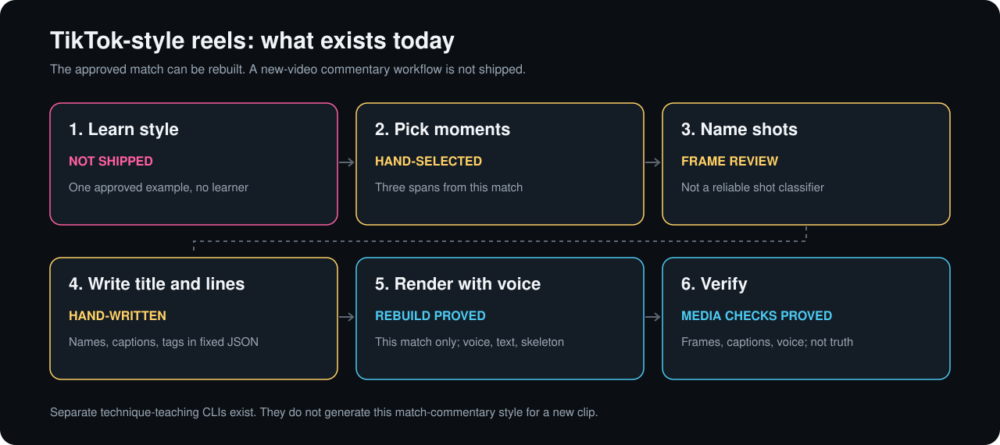

# TikTok-style reel workflow

The repo has two commentary paths. `scripts/render_reels.py` rebuilds the approved, hand-edited Han Yue versus Wang Zhiyi reel. The experimental `coach.tiktok_reel` analyzes a new singles video, selects supported excerpts, writes short Chinese lines, and renders. It also accepts a reviewed plan. Neither path learns a commentary style or establishes whole-match shot accuracy.



Follow [Make a commentary reel from a new video](new-match-commentary.md) for the command, model downloads, source attribution, and editable-plan route.

## What exists

| Path | What it does | Evidence and limit |
|---|---|---|
| [`coach.tiktok_reel`](../coach/tiktok_reel.py) | Fresh court, pose, and shuttle inference, candidate selection, short Chinese lines, and source-bound rendering | Experimental. Clear and lift names require strong trajectory evidence. Other lines use supported placement or sequence context. Drafts distinguish agent review from actual human attestation |
| [`scripts/render_reels.py`](../scripts/render_reels.py) | Rebuilds the technical commentary, base, and earlier coaching editions from source frames, shipped pose estimates, and narration inputs | [Clean-checkout proof](reproduction-check.md), including freshly synthesized technical speech. The source hash, selections, player mapping, and scripts belong to this match |
| [`coach.short_review`](../coach/short_review.py) | Runs fresh Fast pose analysis and selects three supported teaching examples for a vertical short | Fresh clip-04 export passed. Its hook is fixed to `这一跨，学三个关键`. This is a technique lesson, not the approved match-commentary format |
| [`coach.editorial_short`](../coach/editorial_short.py) | Runs fresh Fast analysis for a legs, core, tactics, and arms breakdown | Fresh public recut clip-04 export passed, but varying voice length can trigger speech-fit rejection on another run. This is not a generator of named-shot commentary |
| [`coach.verify_short`](../coach/verify_short.py) | Rechecks the teaching short against its source and saved pose evidence | Passed on the freshly generated technique short. It samples 10 encoded pictures and every planned caption's audible audio. It is not the all-frame commentary checker or an editorial-short verifier |
| [`studio/editorial/viral-v3/run_render.py`](../studio/editorial/viral-v3/run_render.py) and [`studio/commentary/`](../studio/commentary/) | Preserve the earlier editing and commentary code | Historical entry points retain dependencies on old run folders. Use `scripts/render_reels.py` for the supported reproduction command |

All three new-video exporters are CLI-only. The app exports a continuous narrated review. The teaching exporters do not generate commentary. `coach.tiktok_reel` uses the commentary layout and voice, but its rule-based choices are not a learned editorial style.

## What the approved script shows

These are editorial choices visible in the shipped [technical script](../studio/reels/technical-script.json), not rules learned by a style model. The new CLI uses short templates tied to observed shot, placement, and sequence evidence.

- Name the players. The title names Han Yue and Wang Zhiyi, and spoken lines identify who attacks or defends.
- Use specific badminton terms rather than only describing visible movement. Examples include `反手斜线拦截`, `底线暴力跳杀`, `接杀走对角`, and `杀吊结合`.
- Keep speech short. The final script replaces longer explanatory paragraphs with brief shot calls and reactions such as `神仙防守！`. It does not have an automatic test for obvious or unhelpful commentary.
- Put measured numbers in on-screen tags, not in the spoken lines. For example, `韩悦底线暴力跳杀！` is spoken while `跳杀 · 约 0.5 秒到接杀` appears as a tag.

The reference match's choices and wording were edited by hand. Its shot names came from frame review, not a validated shot classifier. The new CLI instead names few families and abstains when evidence is weak. Timing and metres remain model estimates. Neither path proves that a reel will attract viewers.

## What the six steps mean today

| Step | Current state |
|---|---|
| Learn style | Not shipped. The script preserves one approved example, not a style-learning workflow |
| Pick moments | The reference uses three hand-selected spans. The new CLI ranks candidate rallies by observed returns, supported wording, identity evidence, and line diversity. This is not a validated excitement score |
| Name shots | The reference terms came from frame review. The new CLI conservatively names clear or lift, otherwise uses supported tactics or abstains. The old tactics engine still fails its 80% recall goal |
| Write title and lines | The new CLI fills a player-named hook and short rules from evidence, including deep-then-short context. `plan.json` can be edited. There is no style learner |
| Render with voice | The reference rebuild remains separate. The new renderer accepts automatic or reviewed plans, measures fresh Kokoro speech, and schedules it after the action cue. Source aspect ratio is preserved |
| Verify | New-output checks decode every frame, distinguish title, green tag, and white captions from missing-text controls, and check each encoded voice slot. Missing text and muted narration fail. These checks do not approve shot names or voice naturalness |

## Rebuild or use a teaching exporter

To rebuild the approved example, follow [Rebuild the short reels](reproducibility.md#rebuild-the-short-reels). Exact historical MP4s remain in [release v0.1.0](../results/README.md). Rebuilt equivalents and fresh speech are not claimed to have the same bytes.

For fresh technique analysis on a supplied clip, use the separate [teaching exporter commands](../coach/README.md#vertical-technique-short-experimental). They require the full app dependencies, detector models, prepared Fast cache, local MeloTTS voice, and source attribution. Do not treat those commands as automatic commentary production or as validated on arbitrary footage.

## Fresh-clip command check

The [machine-readable receipt](../results/reproduction/any-clip-commands.json) records commands, source and output hashes, fresh-inference timings, and decoded-output checks. It started from clean revision `10873df`, installed the full declared app requirements, exported both public YOLO models with matching recorded hashes, prepared the Fast cache, and recut clip 04 through `get_footage.py`. Model export also installed its missing optional `onnxruntime` dependency.

```powershell
python -X utf8 -B -m coach.short_review sample-videos\04-china-open-ws-a.mp4 outputs\any-clip-short-fresh
python -X utf8 -B -m coach.verify_short outputs\any-clip-short-fresh sample-videos\04-china-open-ws-a.mp4
python -X utf8 -B -m coach.editorial_short sample-videos\04-china-open-ws-a.mp4 outputs\any-clip-editorial-fresh
```

The technique short passed. Its MP4 has 938 frames, 31.266667 seconds, 1080 by 1920 pixels, and SHA256 `2cfe0f59128e2711f06bab595e879bbdc8054a70d4e434db3005f5784557087a`. That hash records this run only, not expected regenerated bytes: fresh voice and MP4 bytes vary between runs. The run used fresh Fast inference on 900 input frames, not a stored pose replay. The encoded recheck reproduced the selected evidence, checked all 10 planned picture samples and caption audio windows, and confirmed H.264, AAC, faststart, and no selected excerpt crossing a cut.

The earlier editorial attempts failed before encoding. The first requested an initial court anchor at frame 53, outside its sampled range of frames 60 through 210, even though frame 53 had measured ankles. The bounded correction includes that requested frame in the scan. A regression fails on the original code and passes with the correction. No confidence gate or fallback changed.

A fresh editorial retry with that correction initially failed the legs speech-fit guard. Repeating the unchanged command at revision `0f3a9e68` then succeeded on the first new attempt: 491 independently decoded frames, 16.366667 seconds, 1080 by 1920 pixels, and AAC audio. All eight booleans in its own `verification.json` are true. The [receipt](../results/reproduction/any-clip-commands.json) records that output's SHA256 as an individual-run record, not an expected regeneration hash.

The fresh pose puts the legs chapter's lowest point at frame 87 rather than the stored fixture's 89. At 0.35x playback, that gives 63 forward frames (source frames 68 through 89), rather than the fixture's 69 (68 through 91). The guard needs `ceil((voice length + 0.24 s) * 30)` frames, so the fresh window fits speech up to 1.860 seconds. Ten separate fresh processes synthesized `右脚跨出，前膝弯下。` at speed 1.08: lengths ranged from 1.834626 to 2.058277 seconds; seven needed at most 63 frames and three needed more. The successful export's line lasted 1.848345 seconds and needed 63 frames. These counts describe the measured sample, not a guaranteed success rate.

Thus `coach.editorial_short` on public recut clip 04 passes or is rejected depending on the run. Re-run after a speech-fit rejection. The guard, thresholds, narration, speed, and window selection are unchanged; a longer-window fix is not implemented. The earlier claim that the stored-pose test class also failed was incorrect: the 12-test module (11 existing tests and the anchor regression) passed at `0f3a9e68`. A scratch run of the original `e27fb934` class with the same current venv and models also passed all 11 tests.

Single functional wall times were 88.14 seconds for technique export and 6.34 seconds for its recheck. The earlier failed editorial attempts took 13.60 and 27.12 seconds; the successful retry took 71.10 seconds. The retry observed speech duration with a read-only function-return profiler; it did not alter the samples or renderer. These include startup and validation on a shared 16-logical-CPU host. They are execution receipts, not speed benchmarks or estimates of arbitrary-video runtime.

No human listening or naturalness review is claimed. Media attribution and the caveat about uncleared upstream broadcast rights still apply.
